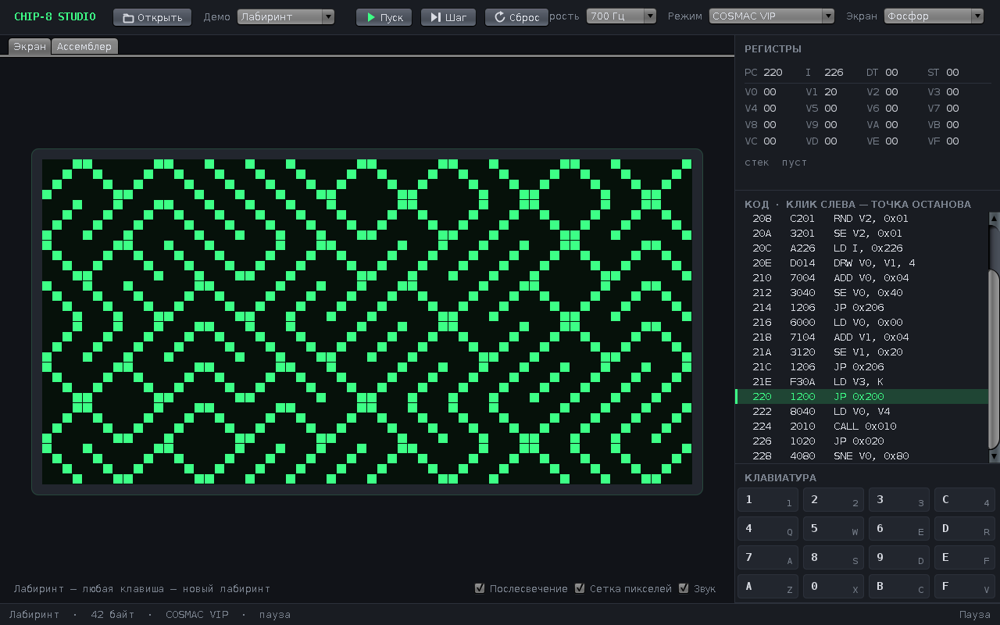

# CHIP-8 Studio: эмулятор, отладчик и ассемблер CHIP-8

Настольная мастерская для CHIP-8, виртуальной машины 1977 года, на которой до сих пор учатся писать эмуляторы. Запускает старые ROM-файлы, показывает регистры и дизассемблированный код, останавливается на точках останова, а встроенный ассемблер позволяет написать свою игру и сразу её запустить. Всё на чистой Java: без зависимостей, один jar.


[](https://github.com/whysafe/chip8-studio/actions/workflows/build.yml)



## Возможности

**Эмуляция**
- Все 35 инструкций CHIP-8, таймеры 60 Гц, звук (меандр 440 Гц), экран 64×32 с XOR-рисованием
- Два набора совместимости: оригинальный COSMAC VIP и CHIP-48/SUPER-CHIP. Переключаются на лету: сдвиги через VY, сброс VF после логических операций, инкремент I в FX55/FX65, переход BXNN, обрезка спрайтов у края
- FX0A срабатывает на отпускание клавиши, как на настоящем VIP, поэтому игры не «проскакивают» меню
- Скорость от 200 до 10 000 инструкций в секунду
- Послесвечение экрана: погасший пиксель затухает за несколько кадров, и типичное для CHIP-8 мерцание спрайтов пропадает
- Пять палитр экрана: зелёный фосфор, янтарь, карманный LCD, бумага, лёд

**Отладка**
- Регистры V0–VF, I, PC, таймеры и стек вызовов; изменившиеся значения подсвечиваются
- Листинг программы с текущей инструкцией, клик слева от строки ставит точку останова
- Пауза (F5), шаг по одной инструкции (F10), сброс (Ctrl+R)
- Ошибки программы (неизвестный опкод, переполнение стека, RET без CALL) останавливают машину с адресом, а не роняют приложение

**Ассемблер и дизассемблер**
- Синтаксис классического справочника Cowgod: `LD V0, 10`, `DRW V1, V2, 5`, `LD [I], V3`
- Метки до и после использования, константы `EQU`, выражения `sprites + 8`, числа `0x1F`, `#1F`, `0b1010`, `-1`
- Директивы `DB` и `DW`; ошибки с номером строки, которая подсвечивается в редакторе
- Открытый ROM дизассемблируется во вкладку «Ассемблер»: можно поправить код и собрать заново, байты совпадут один в один
- Сборка и запуск по Ctrl+Enter

**Удобство**
- Клавиатура CHIP-8 на левом блоке клавиш (1234 / QWER / ASDF / ZXCV) по положению клавиш, поэтому работает и в русской раскладке; клавиши можно нажимать и мышью
- ROM или исходник можно перетащить прямо в окно
- Режим командной строки: сборка, дизассемблирование и запуск без окна с выводом экрана в терминал

**Встроенные демо** (исходники в [`src/main/resources/demos`](src/main/resources/demos))
- «Сквош»: отбивайте мяч платформой, счёт и гудки (A/D)
- «Лабиринт»: классический генератор лабиринта из случайных диагоналей
- «Отскок»: анимация на таймере задержки
- «Клавиши»: проверка раскладки, показывает код нажатой клавиши

## Стек

Java 8+ (Swing, Java2D, javax.sound), Maven, JUnit 5, GitHub Actions. Внешних библиотек в рантайме нет.

## Запуск

Нужна Java 8 или новее и Maven.

```bash
git clone https://github.com/whysafe/chip8-studio.git
cd chip8-studio
mvn -B package
java -jar target/chip8-studio.jar
```

Готовый jar также собирается в каждом прогоне GitHub Actions (артефакт `chip8-studio`).

Открыть конкретный файл:

```bash
java -jar target/chip8-studio.jar games/pong.ch8
```

Командная строка:

```bash
java -jar target/chip8-studio.jar asm my-game.c8s -o my-game.ch8
java -jar target/chip8-studio.jar disasm my-game.ch8
java -jar target/chip8-studio.jar run demo:maze --cycles 3000 --seed 8
java -jar target/chip8-studio.jar run my-game.ch8 --quirks modern
```

`run` выполняет программу без окна и печатает экран:

```
#...#......#...#...#.......#...#.......#...#.......#...#...#.....
.#.#......#.....#.#.......#.....#.....#.....#.....#.....#.#......
..#......#.......#.......#.......#...#.......#...#.......#.......
.#.#....#.......#.#.....#.........#.#.........#.#.......#.#......
PC=232 I=23A циклов=1158 (ждёт клавишу)
```

Свои ROM ищите в открытых сборниках, например [chip8Archive](https://johnearnest.github.io/chip8Archive/) (игры под публичными лицензиями) или [Timendus/chip8-test-suite](https://github.com/Timendus/chip8-test-suite) для проверки совместимости.

## Пример программы

```asm
; Точка бегает по экрану слева направо
        LD I, dot
        LD V0, 0
        LD V1, 16
loop:   DRW V0, V1, 1
        DRW V0, V1, 1       ; повторный XOR стирает точку
        ADD V0, 1
        JP loop
dot:    DB 0b10000000
```

## Как устроено

```
ru.whysafe.chip8
├── core/   Chip8 (память, регистры, стек, декодирование), Display, Quirks
├── asm/    Assembler (два прохода), Disassembler
├── ui/     Studio (окно), EmulatorController, ScreenPanel, RegistersPanel,
│           DisassemblyPanel, KeypadPanel, EditorPanel, Beeper, Theme, Icons
├── Demos   встроенные программы (исходники .c8s в ресурсах)
└── Main    разбор командной строки
```

- **Ядро не знает про интерфейс.** `Chip8` — обычный объект с методами `step()`, `tickTimers()`, `pressKey()`; его одинаково используют окно, консольный режим и тесты. Случайные числа берутся из переданного `Random`, поэтому прогоны воспроизводимы.
- **Часы.** `EmulatorController` тикает таймером Swing 60 раз в секунду и в каждом кадре выполняет `скорость / 60` инструкций; дробный остаток переносится в следующий кадр, так что 700 Гц — это действительно 700 инструкций в секунду. Всё происходит в потоке событий Swing, без блокировок.
- **Звук** живёт в своём потоке и пишет в `SourceDataLine` кусками по 10 мс: тишину или меандр, в зависимости от флага. Включение и выключение мгновенные, а без звуковой карты эмулятор просто молчит.
- **Ассемблер.** Первый проход раскладывает адреса и собирает метки и константы, второй кодирует команды, поэтому метки можно использовать до объявления. Дизассемблер выдаёт ровно тот синтаксис, который ассемблер принимает: тест проверяет обратную сборку всех 65 536 возможных опкодов.
- **Послесвечение** хранится в панели экрана, а не в ядре: машина видит честные XOR-пиксели, а яркость затухания — чисто визуальный эффект.

## Тесты

```bash
mvn -B verify
```

52 теста на JUnit 5: арифметика и флаги, все наборы совместимости, рисование с обрезкой и переносом, стек и ошибки, ожидание клавиши, таймеры; кодирование каждой инструкции, метки, константы и сообщения об ошибках ассемблера; обратная сборка всех опкодов и случайного ROM; прогон каждого демо в обоих режимах, включая проверку, что в «Сквоше» платформа слушается клавиш, а пропущенный мяч заканчивает игру. GitHub Actions дополнительно запускает консольный режим и рендерит окно в виртуальном дисплее.

## Автор

**whysafe** — fullstack- и Unity-разработчик, на фрилансе с 2023 года. Python, JavaScript/TypeScript, PHP, Java, Kotlin, C#/Unity, C/Assembly, Linux, базы данных, AI/ML и серверная разработка.

- Сайт: [whysafe.ru](https://whysafe.ru)
- Telegram: [@yawhysafe](https://t.me/yawhysafe) · канал [@whysafe_official](https://t.me/whysafe_official)
- Kwork: [kwork.ru/user/whysafe](https://kwork.ru/user/whysafe)
- Почта: [hello@whysafe.ru](mailto:hello@whysafe.ru)

Лицензия MIT.
